# Arduino-Based MPPT for Solar Energy Harvesting

A DC-DC **boost converter** controlled by an **Arduino Uno** that adjusts its PWM duty cycle with the **Perturb & Observe (P&O)** algorithm, so that a small solar panel is pushed toward its maximum power point. The project includes an LTspice simulation of the boost stage, a breadboard prototype, a perfboard prototype and outdoor tests with a 10 W class solar panel.

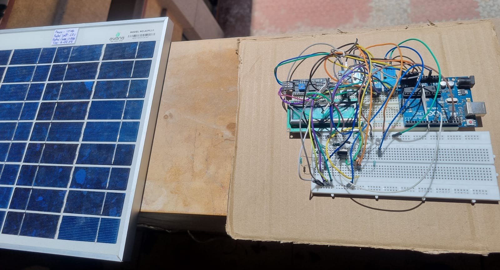

## Contents

1. [Introduction](#introduction)
2. [Objectives](#objectives)
3. [Components](#components)
4. [How the circuit works](#how-the-circuit-works)
5. [Sensing](#sensing)
6. [PWM generation](#pwm-generation)
7. [MPPT algorithm](#mppt-algorithm)
8. [Software simulation](#software-simulation)
9. [Hardware builds](#hardware-builds)
10. [Test observations](#test-observations)
11. [Running the project](#running-the-project)
12. [Repository structure](#repository-structure)
13. [Limitations](#limitations)
14. [Future scope](#future-scope)
15. [Author](#author)

## Introduction

Solar panels do not give constant voltage or current. Their output changes with sunlight, temperature and load, and there is only one voltage and current combination, the **Maximum Power Point (MPP)**, where the panel delivers its highest power. A fixed load usually makes the panel run away from this point and wastes available energy.

An MPPT controller therefore:

1. continuously measures the panel voltage and current,
2. calculates power = V × I,
3. adjusts the operating point by changing the duty cycle of a DC-DC converter,
4. keeps checking, so it can follow changing conditions.

This project implements that idea with an Arduino Uno, a MOSFET switch and a boost converter stage. It is described in the report as a step beyond basic 555-timer boost converters.

## Objectives

- Design and implement a DC-DC boost converter with Arduino control.
- Implement a Perturb & Observe based MPPT algorithm.
- Maximise power extraction from the solar panel under changing conditions.
- Minimise losses by using a MOSFET and a Schottky diode.
- Provide a voltage output suitable for powering small devices or charging batteries.
- Understand practical challenges of solar systems such as partial shading, temperature variation and dynamic loads.

## Components

| No. | Component | Specification / model |
|---|---|---|
| 1 | Solar panel | 10 W, 12 V class |
| 2 | Microcontroller | Arduino Uno |
| 3 | MOSFET | IRLZ44N (logic-level N-channel) |
| 4 | Resistor | 1 kΩ |
| 5 | Capacitors | 470 µF (input and output), 100 nF bypass |
| 6 | Inductor | 220 µH |
| 7 | Current sensor | ACS712 (5 A version), two modules |
| 8 | Voltage sensor | DC 0 to 25 V module, 30 kΩ / 7.5 kΩ divider, two modules |
| 9 | Display | 16×2 I2C LCD |
| 10 | Diode | 1N5822 Schottky |
| 11 | Load | Resistor and LED |
| 12 | Prototyping | Breadboard, perfboard, 15 W soldering iron |

Role of the main parts:

- **Arduino Uno** reads voltage and current, runs the MPPT algorithm and outputs the PWM signal.
- **IRLZ44N** works as the high-speed switch controlled by the Arduino PWM. It has a lower voltage drop than a BJT.
- **1N5822 Schottky diode** conducts when the MOSFET turns off. Its forward drop is low (about 0.3 V to 0.4 V) compared to a silicon diode (about 0.7 V).
- **220 µH inductor** stores energy while the MOSFET is on and releases it while the MOSFET is off.
- **Capacitors** smooth the input and output voltage; 100 nF capacitors filter high-frequency noise.
- **ACS712 and voltage dividers** give the Arduino the data to calculate instantaneous power.

## How the circuit works

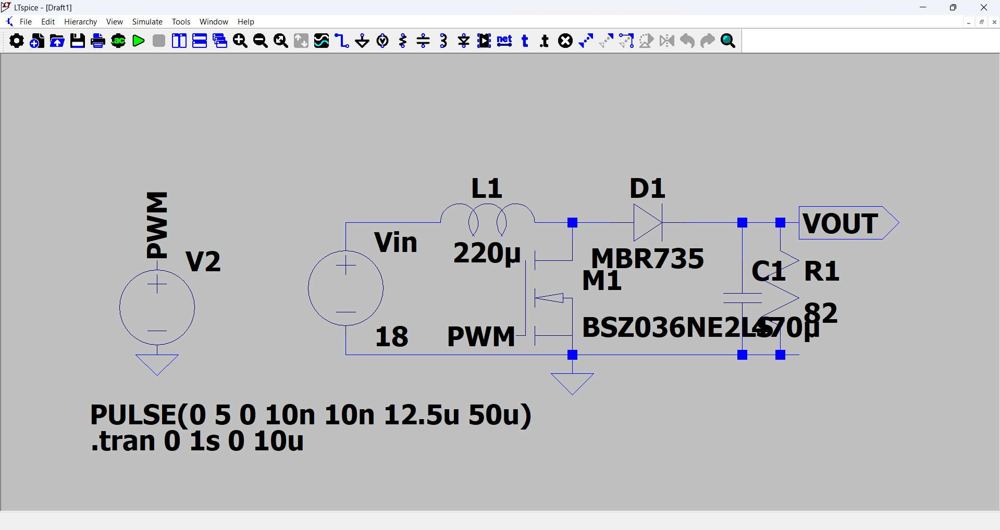

*Fig. 8.1: Project circuit diagram (software)*

The power stage is a standard boost converter: panel, inductor, MOSFET to ground, diode, output capacitor and load.

| MOSFET state | What happens |
|---|---|
| **ON** (PWM high) | The MOSFET connects the inductor to ground. The inductor stores energy as a magnetic field. The diode is reverse biased and blocks. |
| **OFF** (PWM low) | The field collapses. The stored energy is released to the load through the now forward-biased diode. |

The output is therefore higher than the input. For an ideal converter in continuous conduction the gain is Vout = Vin / (1 − D), with D the duty cycle.

Sensor placement described in the report:

- **Voltage sensors:** dividers (30 kΩ and 7.5 kΩ) that bring the high voltage into the 0 to 5 V range of the Arduino analog pins; one on the input and one on the output.
- **Input current sensor:** ACS712 in series with the solar panel (or backup supply) line.
- **Output current sensor:** ACS712 in series with the load (resistor and LED) after the diode.
- **Load:** a resistor for current limiting and an LED as a visible indicator, with the output sensors connected for real-time monitoring.

Step-by-step operation:

1. The solar panel (or a bench supply) provides the input voltage.
2. The voltage goes to the inductor and to the MOSFET controlled by the Arduino.
3. The Arduino reads input voltage and current.
4. It adjusts the PWM duty cycle with the MPPT algorithm.
5. The inductor stores energy while the MOSFET is on and releases it through the diode when it is off.
6. The output voltage is boosted.
7. The sensors measure output voltage and current.
8. Real-time data is shown on the LCD and sent to the Serial Monitor/Plotter.

## Sensing

### Voltage (resistor divider)

The divider reduces the voltage in proportion to its resistor ratio:

```
Vpin = Vbus × R2 / (R1 + R2)        R1 = 30 kΩ, R2 = 7.5 kΩ   →   Vpin = Vbus × 0.2
```

The code reads the ADC value, converts it to volts (`raw × 5.0 / 1024`) and divides by the ratio, so the divider supports voltages up to about 25 V.

### Current (ACS712, 5 A version)

The ACS712 is a Hall-effect sensor. Its output is linear in the current: about 2.5 V at 0 A, rising for positive current and falling for negative, with a sensitivity of about 185 mV per ampere. The program:

1. averages 200 readings at start-up to find the "zero current" level,
2. subtracts this level from each reading,
3. converts the difference to volts and divides by 0.185 V/A,
4. averages 50 such readings for each loop pass.

## PWM generation

The Arduino generates a **20 kHz** PWM signal on **pin 9** using Timer1 registers directly:

```cpp
TCCR1A |= (1 << COM1A1) | (1 << WGM11);
TCCR1B |= (1 << WGM13) | (1 << WGM12) | (1 << CS10);
ICR1  = 799;      // TOP: 16 MHz / (799 + 1) = 20 kHz
OCR1A = duty;     // 0..799, start value 400 (about 50 %)
```

This is Timer1 fast PWM with the counter top set by `ICR1` and no prescaler. `OCR1A` sets the duty cycle: the MPPT algorithm changes this value to change how much energy is transferred from the panel to the load.

## MPPT algorithm

Perturb & Observe: perturb the duty cycle a little, observe whether the input power went up or down, and keep or reverse the direction accordingly.

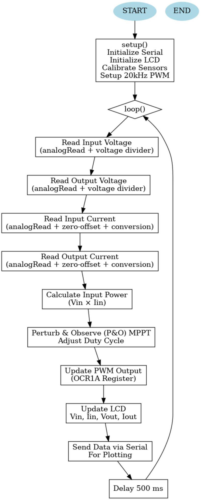

*Section 8.9: algorithm / flowchart from the report*

The same logic as implemented in the code, drawn as a flowchart:

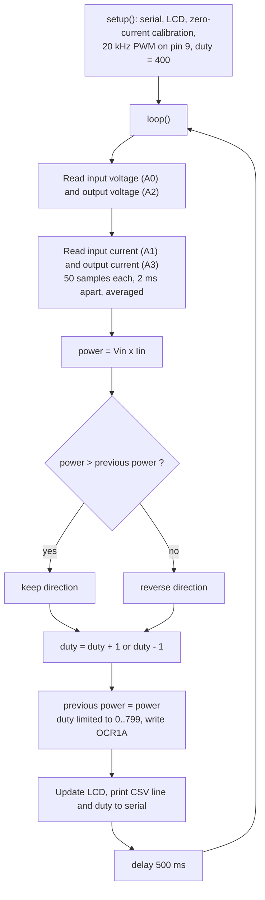

Parameters of the implementation:

| Parameter | Value |
|---|---|
| PWM frequency | 20 kHz (Timer1, pin 9) |
| Duty range | 0 to 799 counts |
| Start duty | 400 counts (about 50 %) |
| Perturbation step | 1 count |
| Loop delay | 500 ms (plus the current averaging time) |
| Serial speed | 9600 baud |

## Software simulation

The boost stage was simulated in LTspice with an 18 V source, 220 µH inductor, 470 µF output capacitor, 82 Ω load, an MBR735 diode and a BSZ036NE2LS MOSFET. The gate is driven by a pulse source `PULSE(0 5 0 10n 10n 12.5u 50u)`, which is 20 kHz at 25 % duty.

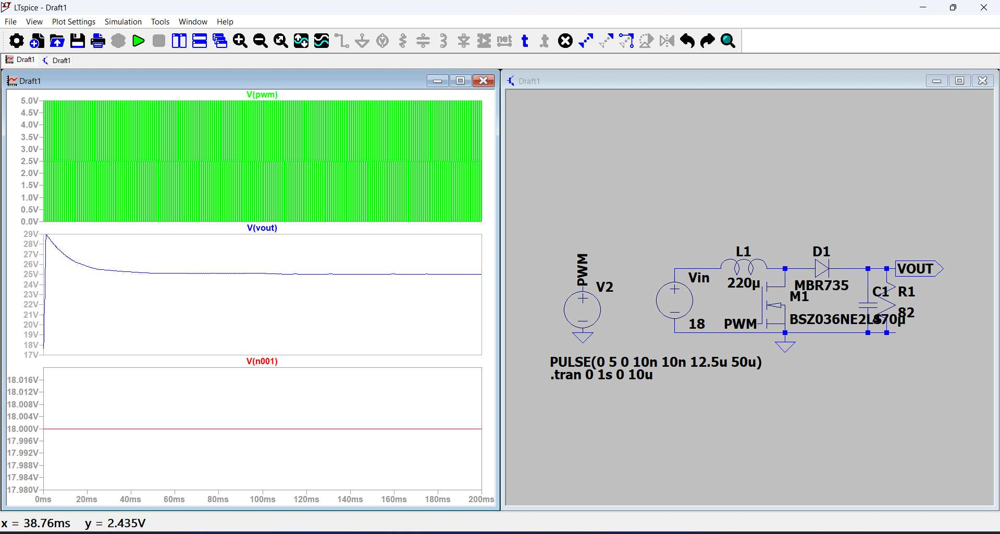

*Fig. 8.2: Project circuit simulation (software). The output voltage starts near 29 V and settles around 25 V.*

## Hardware builds

| | |
|---|---|
| 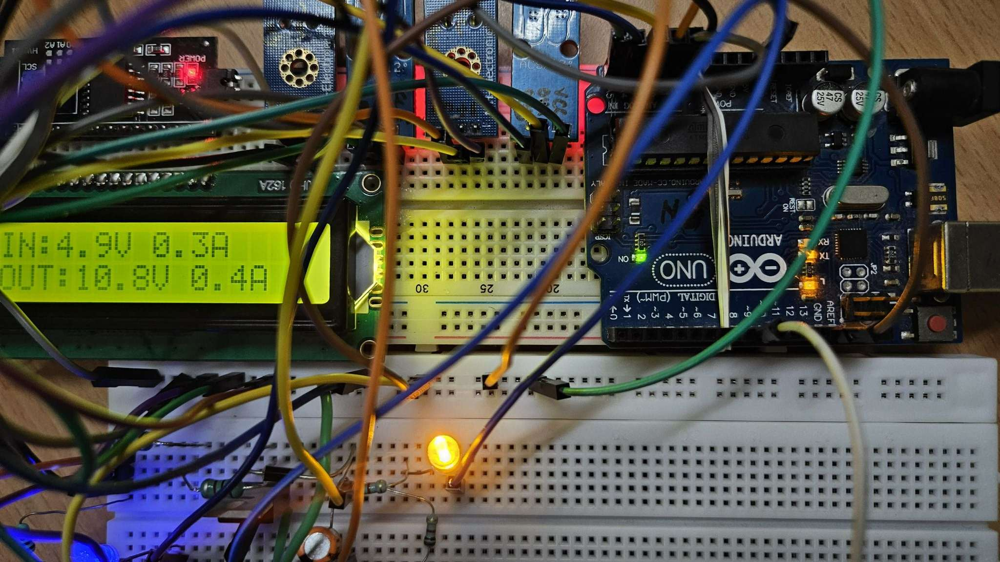 | 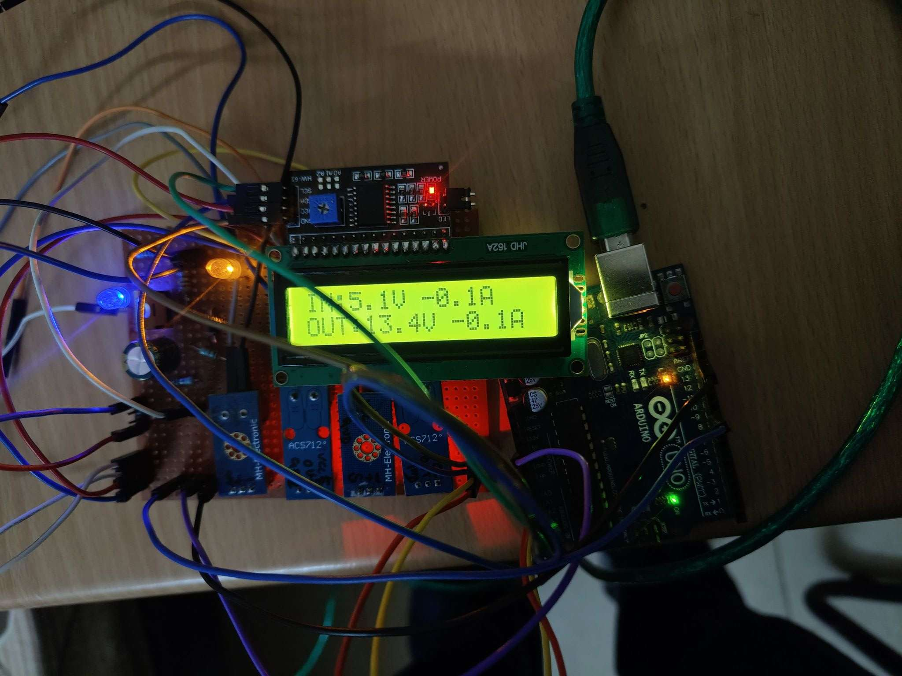 |
| Fig. 8.3: circuit on breadboard | Fig. 8.4: circuit on perfboard (PCB) |

| | |
|---|---|
| 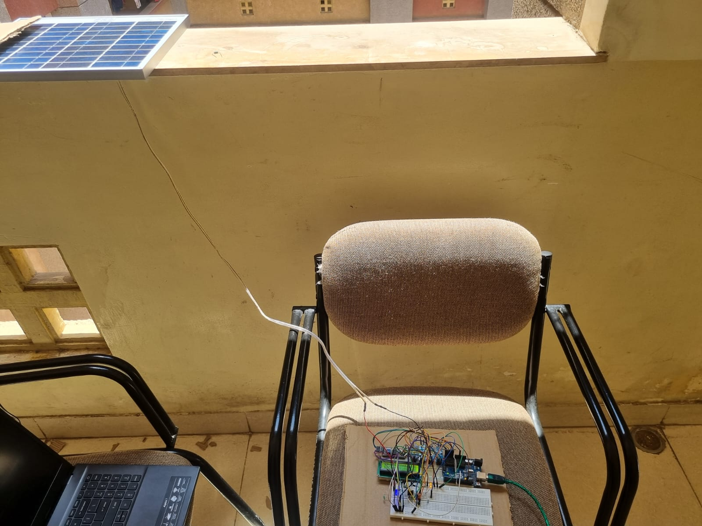 |  |
| Fig. 8.5: setup with the solar panel (outdoor), laptop on the serial port | Panel and controller during the outdoor test |

## Test observations

These are the observations given in the report, read from the LCD and the Serial Monitor.

| Test | Conditions | Observation |
|---|---|---|
| Outdoor with solar panel (Fig. 8.6) | Sunlight | Input voltage fluctuates between 7 V and 9 V; output voltage between 17 V and 20 V |
| Indoor with solar panel (Fig. 8.7) | Indoor light | Input 5 V to 6 V; output 13 V to 14 V. Current is in the microampere range, so the sensor could not sense it (the LCD shows -0.1 A) |
| Bench power supply (Fig. 8.8) | 12 V supply | Output voltage fluctuates between 20 V and 23 V |
| Serial output (Fig. 8.9) | Running MPPT | The duty cycle changes with the input power |

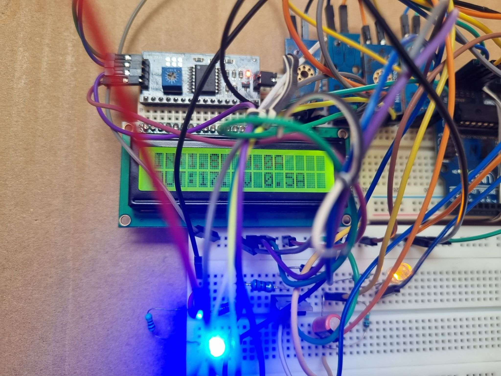

*Fig. 8.6: output with the solar panel, input 7 V to 9 V and output 17 V to 20 V (outdoor)*

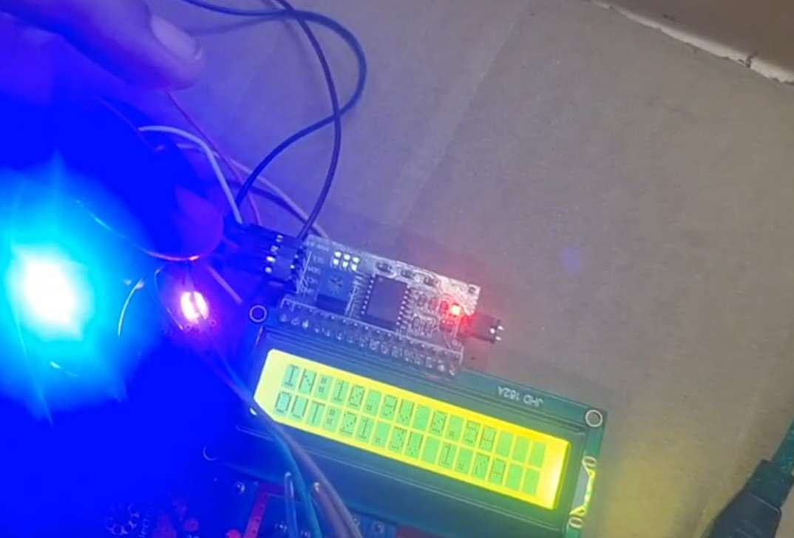

*Fig. 8.8: output with a 12 V power supply, output 20 V to 23 V*

Serial Monitor excerpt (Fig. 8.9, "Duty cycle is changing with the input power (MPPT)"):

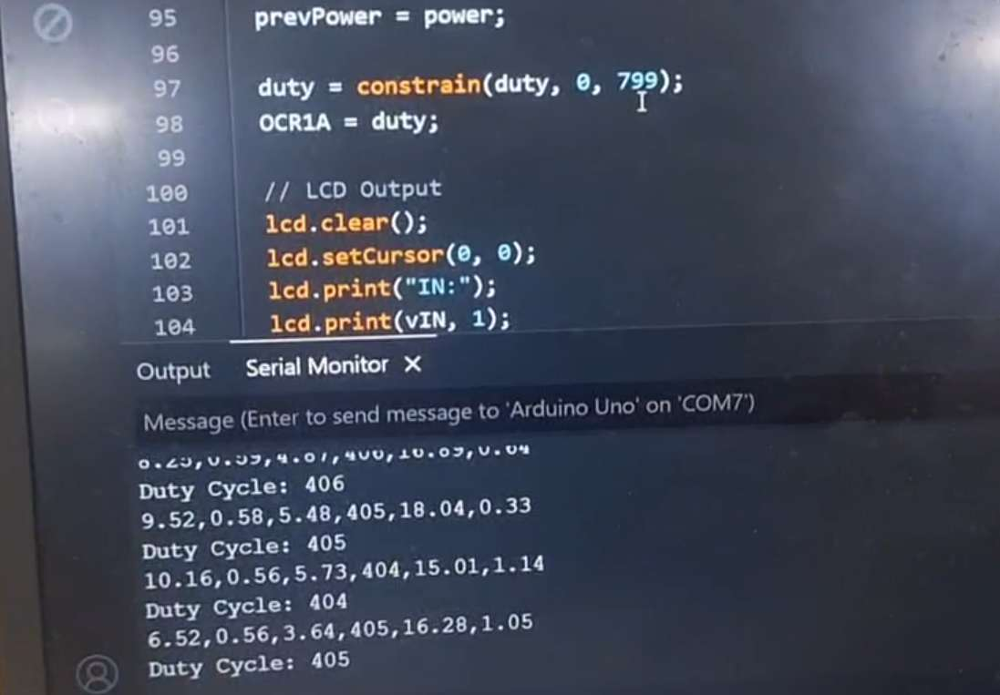

| Vin [V] | Iin [A] | Power [W] | Duty | Vout [V] | Iout [A] |
|---|---|---|---|---|---|
| 9.52 | 0.58 | 5.48 | 405 | 18.04 | 0.33 |
| 10.16 | 0.56 | 5.73 | 404 | 15.01 | 1.14 |
| 6.52 | 0.56 | 3.64 | 405 | 16.28 | 1.05 |

## Running the project

**Requirements:** Arduino IDE, Arduino Uno, and the **LiquidCrystal I2C** library (Library Manager).

1. Build the circuit of Fig. 8.1 with the parts in the table above.
2. Connect the sensors and display to the Arduino as follows (from the code):

   | Arduino pin | Connected to |
   |---|---|
   | A0 | Input voltage sensor (divider) |
   | A1 | Input current sensor (ACS712) |
   | A2 | Output voltage sensor (divider) |
   | A3 | Output current sensor (ACS712) |
   | D9 | MOSFET gate (PWM, 20 kHz) |
   | SDA / SCL (A4 / A5) | I2C LCD, address `0x27` |

3. Open `mppt_arduino/mppt_arduino.ino`, select **Arduino Uno** and upload.
4. Keep the converter with no panel current during the first seconds after reset, because the zero-current level of the ACS712 sensors is measured at start-up.
5. Open the Serial Monitor at **9600 baud** to see the CSV output (`Vin,Iin,Power,Duty,Vout,Iout`), or use the Serial Plotter. The LCD shows input and output voltage and current.

If your LCD does not respond, change the I2C address `0x27` in the sketch (many modules use `0x3F`).

## Repository structure

```
.
├── README.md
├── mppt_arduino/
│   └── mppt_arduino.ino        Arduino sketch from the report (Section 8.8)
└── images/                     circuit, simulation, hardware photos, flowchart, results
```

## Limitations

Stated plainly, so that the results above are read correctly:

- Measurements are readings from the LCD and Serial Monitor. No efficiency, tracking-efficiency or irradiance data was recorded.
- The LTspice simulation used different parts (MBR735 diode, BSZ036NE2LS MOSFET) from the hardware (1N5822, IRLZ44N), and a different operating point (18 V in, 25 % duty) from the bench readings.
- The tested load was a resistor with an LED, and no battery was charged.
- The current sensors read poorly at very small currents (indoor test shows -0.1 A).
- The code has no output-voltage limit: the duty cycle is only changed by the P&O rule.

## Future scope

- Record input power, output power and irradiance to measure converter efficiency and tracking performance.
- Test partial shading and temperature variation, which the objectives mention.
- Charge a battery as the load.
- Compare P&O with other MPPT methods.

## Author

[Your Name] · [LinkedIn](https://www.linkedin.com/in/your-profile) · [GitHub](https://github.com/amanjaiswal-07)
